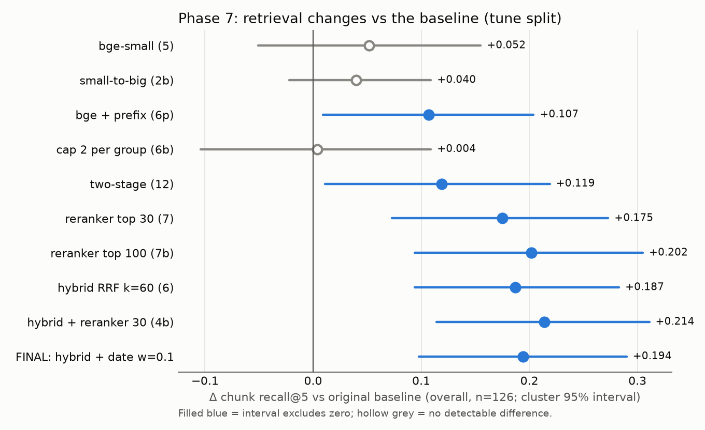
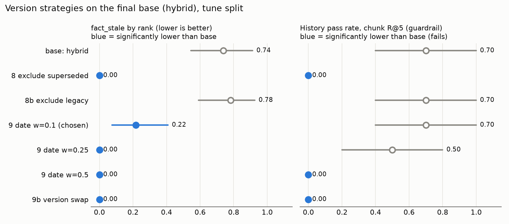

# RAG System: Evaluating Retrieval Over Versioned Company Documents

A local question-answering system over ~300–500 company-style documents (GitLab public handbook
plus public policy PDFs). Answers come with `[1]`, `[2]` citations, or the system declines with
"I couldn't find this in the documents."

**Main focus: evaluation.** Retrieval is measured separately from answer generation.

**Research question:** when outdated and current versions of a policy both exist, how often does
the system use the old one, and which fix reduces that more: filtering to current versions or
date-aware reranking?

> **Synthetic versions:** the "old" values in outdated_version and history questions (and in `data/synthetic/`) are **invented for this evaluation**. They are deliberately changed copies of current GitLab handbook pages, **not real GitLab history**. Only the two real_pair questions use real old versions (GitLab Testing Agreement v1-v4, University of Cambridge 2022 draft policy).

## Findings

_TODO (Phase 10): headline results._

## Results

All decisions follow rules written down before the runs (see [NOTES.md](NOTES.md)). A change counts as an
improvement only if the paired 95% interval of its per-question difference excludes zero; intervals resample
clusters of linked questions (questions sharing a gold chunk or fact), so 126 tune questions count as 75
independent units. With that, effects below about 0.13 can't be confirmed on the tune split.

### Retrieval (Phase 7, tune split, `overall` = 126 answerable questions)



| Run | Change (one at a time) | chunk R@5 | Verdict |
|---|---|---|---|
| 1 baseline | fixed 500/50 chunks, MiniLM, vector search | 0.496 | reference |
| 2 chunk250 / chunk1000 | chunk size | 0.444 / 0.563 | no detectable difference |
| 2b small2big | search 250-token pieces, return the 500-token chunk | 0.536 | no detectable difference (fact_found ✅) |
| 3 heading | one chunk per markdown section | 0.456 | no detectable difference (fact_found ✅) |
| 4 prefix | title/section prefix | 0.540 | no detectable difference |
| 5 bge | bge-small instead of MiniLM | 0.548 | no detectable difference; new base for runs 6-12 |
| 6 **hybrid** | bge + BM25, reciprocal rank fusion (k = 60) | **0.682** | ✅ vs bge (+0.135), replicated on new questions |
| 6b cap2 | max 2 chunks per version group | 0.500 | ❌ worse (fact_found drops) |
| 7 / 7b reranker | cross-encoder over top 30 / top 100 | 0.671 / 0.698 | ✅ vs bge, replicated |
| 12 two-stage | top 3 documents first, then chunks | 0.615 | ✅ vs bge, borderline; not carried forward |
| hybrid + reranker 30 | both | 0.710 | not better than hybrid alone on R@5 (MRR ✅) |

The 7a "promising" chunking effects did not replicate on 60 new questions; hybrid search and the reranker did.

### Version handling (Phase 7c, on hybrid)



`fact_stale` = share of outdated questions (both versions' fact chunks found) where the OLD fact ranks first.
History questions ask for the previous rule, so a strategy that hides old documents fails them.

| Run | fact_stale | History chunk R@5 | Selected? |
|---|---|---|---|
| hybrid (no version handling) | 0.74 | 0.70 | |
| 8 exclude superseded | 0.00 ✅ | 0.00 ❌ | no: fails history |
| 8b exclude legacy | 0.78 | 0.70 | no: staleness not lowered |
| **9 date-aware rerank, w = 0.1** | **0.22 ✅** | **0.70** | **yes** |
| 9 date-aware, w = 0.25 / 0.5 | 0.00 ✅ / 0.00 ✅ | 0.50 / 0.00 ❌ | no: smallest passing w wins |
| 9b version swap | 0.00 ✅ | 0.00 ❌ | no: fails history |

**Final retrieval configuration: `hybrid_v9w10`** (bge + BM25, RRF k = 60, date-aware rerank w = 0.1).

### Held-out test split (run once each, 33 `overall` questions in 21 clusters)

| Metric | Baseline | Final | Paired Δ [95% CI] |
|---|---|---|---|
| chunk R@5 (main) | 0.364 | **0.697** | **+0.333 [0.16, 0.50] ✅** (11 better / 0 worse) |
| chunk MRR | 0.288 | 0.549 | +0.261 [0.13, 0.41] ✅ |
| fact_stale | 1.00 | **0.14** | −1.00 ✅ (n = 6 both found) |
| fact_found | 0.43 | **1.00** | +0.57 [0.18, 0.87] ✅ |

### Generation (Phase 8)

_TODO (Phase 8): answer accuracy, stale answers, citations, decline threshold (run 10)._

## Failure analysis

_TODO (Phase 8): counts per failure category with examples._

## Limitations

Retrieval (Phase 7; the full list is in [NOTES.md](NOTES.md)):

- **Small test sets.** About 75 independent clusters on tune and 21 on test: only effects of roughly 0.13 or
  more in chunk recall@5 can be confirmed, and smaller ones read as "no detectable difference".
- **Synthetic versions.** Most outdated/current pairs are invented edits of current handbook pages; only the
  two real_pair questions use real old versions. Rankers prefer the old copy in most near-identical pairs, and the size of
  that lean is uncertain (10-23 staleness pairs, clustered on a few documents).
- **Replication is partly in-sample for hybrid and the reranker:** the replication rule was written for the
  chunking effects, and the new questions existed before those runs.
- **The date weight was chosen on 10 history questions;** w = 0.1 is the conservative end of the grid.
- **Corpus skew.** 17 of the first 80 questions use GitLab's expenses page; long policy pages are the hardest.
- **Minor:** the cross-encoder doesn't read ~1.5% of chunk text (512-token limit); 9 step-2 comparisons were
  made without a multiplicity correction (the selected effects are large and replicated).

_TODO (Phase 8): generation limitations (LLM judge, Colab environment, small no_answer n on test)._

## How it works

```
Offline: load files -> extract text + metadata -> detect versions -> chunk -> embed + BM25 index -> chunk store
Online:  question -> vector (bge-small) + BM25 search (top 30 each) -> reciprocal rank fusion (k = 60)
         -> date-aware rerank (w = 0.1) -> top 5 chunks
         -> cross-encoder scores (question, top chunk): decline if below the threshold
         -> LLM answers from those chunks only, with citations -> log everything
```

## How to run

### Setup

```bash
python3 -m venv .venv
source .venv/bin/activate
pip install -r requirements.txt
pytest
```

### Data

Raw documents are **not** committed to git. Every source is listed in
[data/sources.yaml](data/sources.yaml); one command downloads them into `data/raw/`:

```bash
python -m src.download_data
python -m src.ingest
python -m src.inspect_docs --n 5
python -m src.chunking configs/baseline.yaml
python -m src.index configs/baseline.yaml --query "How many days do I have to submit an expense claim?"
python -m src.make_synthetic   # only when data/synthetic/changes.yaml changes; then ingest again
python -m src.testset
```

- **Handbook:** selected sections of the [GitLab public handbook](https://gitlab.com/gitlab-com/content-sites/handbook)
  (people policies, total rewards, hiring, finance, legal, security policies, support licensing):
  393 markdown files, each with its last-commit date from the GitLab API.
- **PDFs:** 20 public policy documents from UK/NZ universities and councils (annual leave, sickness
  absence, hybrid working, whistleblowing, travel and expenses, data protection, IT acceptable use).
- Ingestion writes `data/processed/documents.jsonl` (380 documents after dropping 33 near-empty pages).

### Run an experiment

```bash
python run_experiment.py configs/baseline.yaml
```

Results go to `eval/results/<run_name>/` (`metrics.csv`, `summary.md`, `config.yaml`; the full
per-question log `per_question.jsonl` is git-ignored). Runs use the **tune** split; the test split
needs `--final` and is used once, at the end. Compare two runs (side by side with 95% intervals, plus
per-question better/worse counts):

```bash
python -m src.compare baseline <other_run>
```

One table for several runs against the baseline:

```bash
python -m src.report --name phase7a baseline chunk250 chunk1000 small2big heading prefix bge
```

Each experiment is one YAML file in `configs/` that lists only what it changes from
`configs/default.yaml`. To print the final merged config:

```bash
python -m src.config configs/baseline.yaml
```

### Generate and grade answers (Phase 8)

Generation needs [Ollama](https://ollama.com) with `llama3.1:8b` (generator) and `qwen2.5:7b` (judge). It is
heavy for an 8 GB laptop, so the runs use a free cloud GPU:
[notebooks/phase8_colab.ipynb](notebooks/phase8_colab.ipynb) (Google Colab, T4) or
[notebooks/phase8_kaggle.ipynb](notebooks/phase8_kaggle.ipynb) (Kaggle, background run). Both need
`rag_data.zip` (`data/raw`, `data/processed`, `data/chroma`) uploaded to Drive or as a Kaggle dataset.

```bash
python run_generation.py configs/gen_llama.yaml --limit 5   # smoke test, written to gen_llama_smoke
python run_generation.py configs/gen_llama.yaml             # tune split; resumes from saved answers
python run_generation.py configs/gen_llama.yaml --regrade   # grade saved answers again (judge only)
```

Answers are appended to `generations.jsonl` as they are made, so a disconnected run continues where it
stopped (`--fresh` starts over). Results go to `eval/results/gen_llama/` (`summary.md`, `metrics.csv`,
`decline.csv`, `per_question.csv`, `judge_audit.md`). After downloading a results folder:

```bash
python -m src.check_generation gen_llama           # completeness and config checks, no model loaded
python -m src.compare_gen gen_llama gen_qwen       # paired comparison of two runs (fallback / prompt v2)
```

### Ask questions in the app (Phase 9)

```bash
ollama serve                     # if the Ollama app isn't already running
streamlit run app.py             # opens http://localhost:8501
```

Pick a simulated role (Employee, Legal, Finance), ask a policy question, and get an answer with `[n]` citations
and the excerpts it came from (with their version status), or a decline. Each question is logged to
`logs/queries.jsonl` (git-ignored). The app uses the evaluated pipeline from `configs/app.yaml`.

## Repo layout

```
data/raw/            source documents (git-ignored)
data/processed/      extracted text and chunk store (git-ignored)
data/synthetic/      hand-made outdated policy copies for evaluation (committed)
configs/             default.yaml + one YAML per experiment
src/                 pipeline code (config, ingest, chunking, index, retrieve, generate, grade, qa, evaluate)
eval/questions.jsonl test set (built from eval/questions_source.yaml by src/testset.py)
eval/results/<run>/  per-run metrics (CSV) and charts
run_experiment.py    retrieval runs (Phase 7)
run_generation.py    generation + grading runs (Phase 8)
app.py               Streamlit app (Phase 9)
notebooks/           Colab and Kaggle notebooks for the GPU generation runs
tests/               pytest tests
NOTES.md             build log: decisions and results per phase
```
